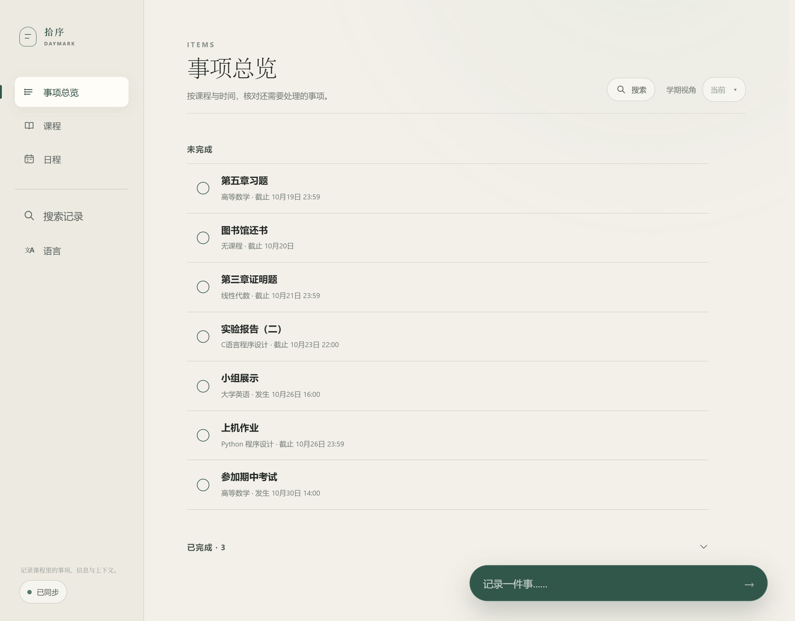
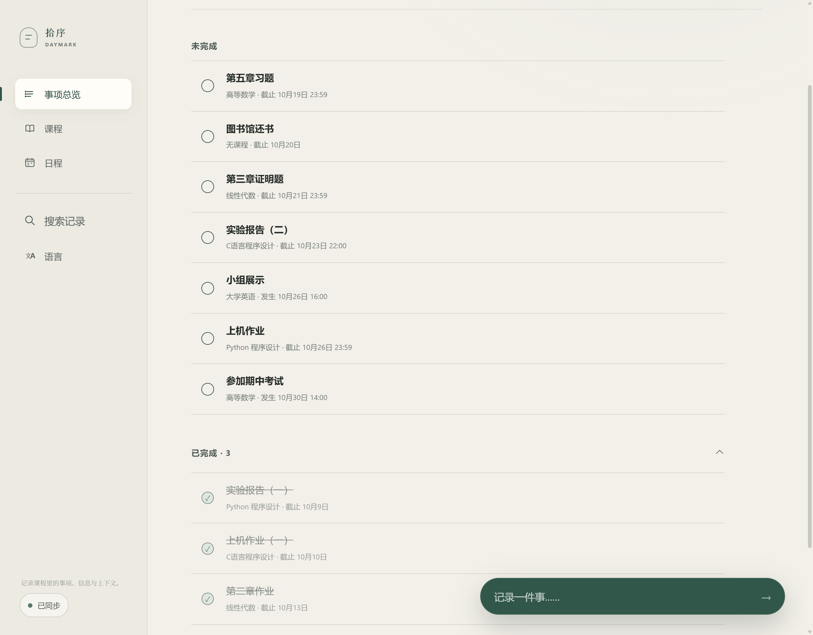
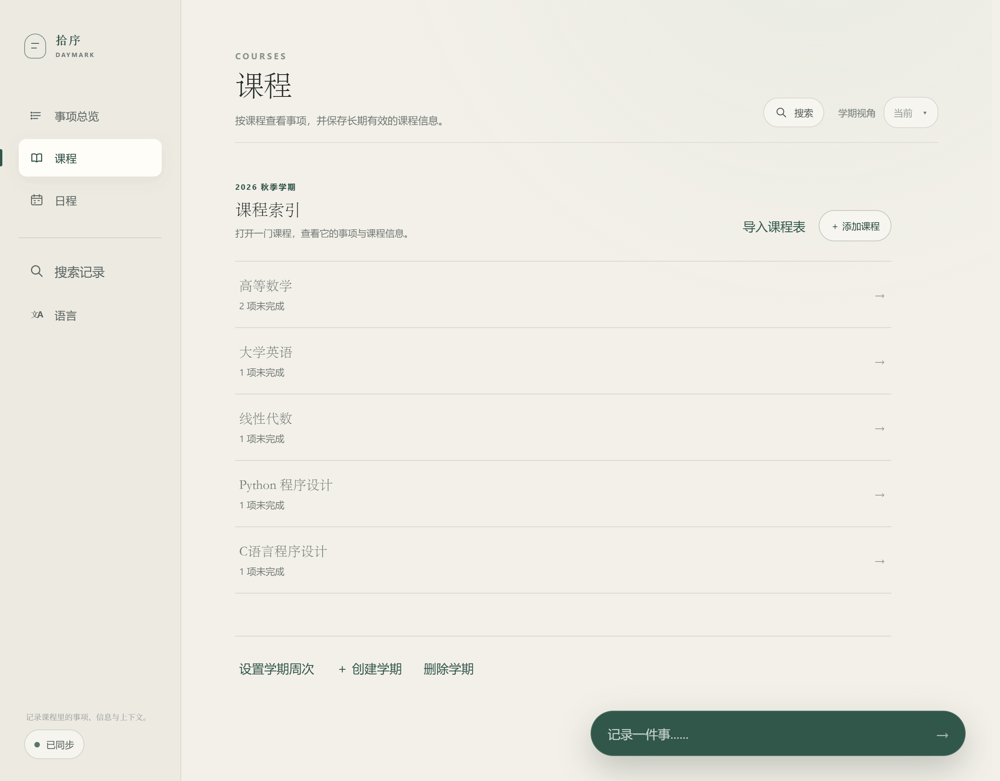
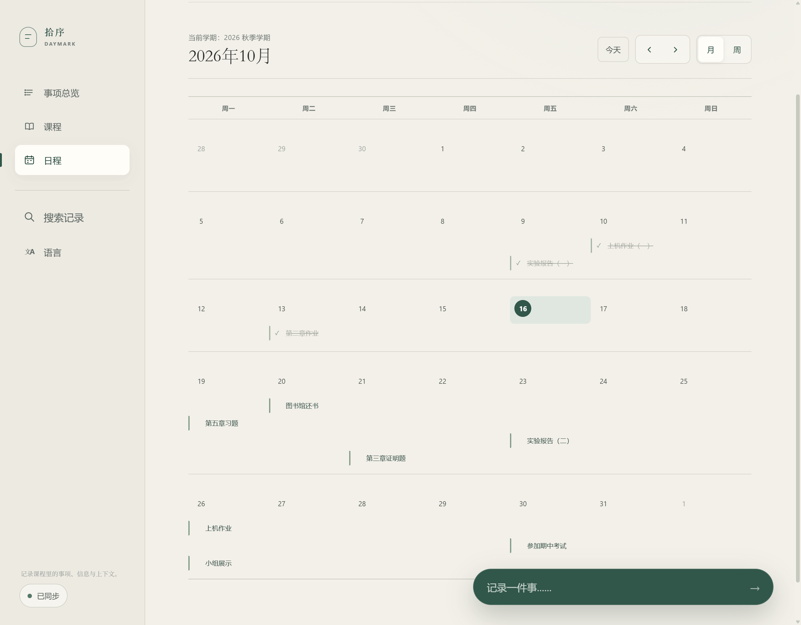
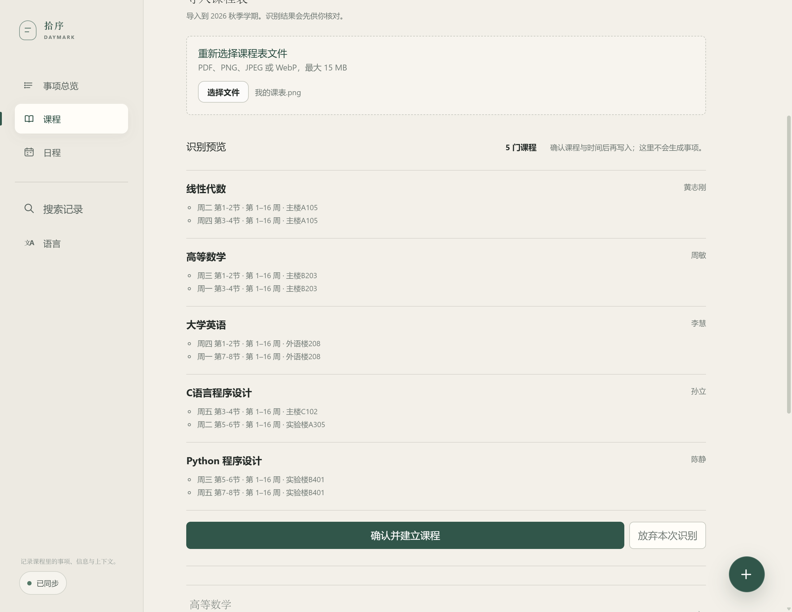
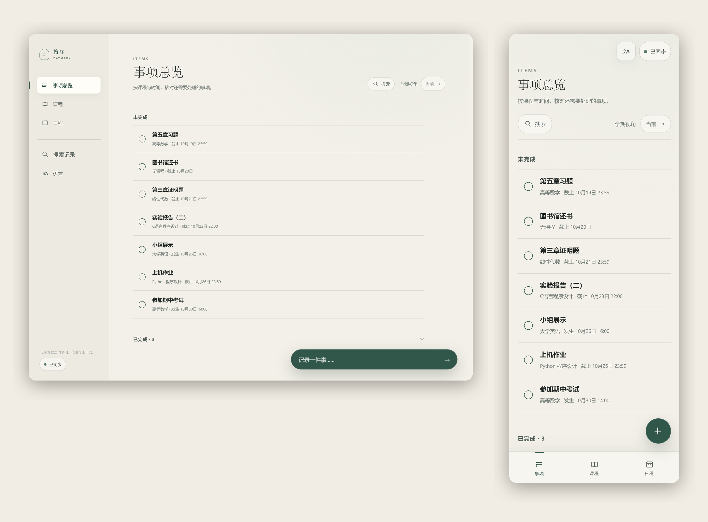

  

<h1 align="center">拾序 Daymark</h1>

  <strong>把散落的校园生活，放回它该在的位置。</strong>

  课程 · 事项 · 日程 · 提醒 · 资料

  <a href="https://daymark.top">官方网站</a>
  ·
  <a href="#下载拾序">下载安装</a>
  ·
  <a href="https://github.com/violetsnowl/Daymark/issues">反馈问题</a>

<!--
SCREENSHOT: HERO
文件：docs/readme/hero.png

这是 README 的第一张产品主视觉，不是普通功能截图。

请使用专门准备的 README Demo 账号进行截图，禁止使用开发者个人账号、
开发测试数据或当前正在开发中的真实数据。

画面要求：
- 展示 Daymark 最核心的「事项总览」
- 数据量适中，不要塞满页面
- 能同时看到几个课程事项、日期/时间以及完成状态
- 数据必须符合真实大学生日常生活
- 页面处于稳定、正常、完成度最高的状态
- 不出现 test、测试、bug、临时事项、开发调试信息
- 不出现真实个人信息
- 整体视觉应该有足够留白

截图重点不是「证明有这个页面」，而是让第一次看到 Daymark
的人在 3 秒内理解：这是一个认真做过的大学生活管理产品。

建议截图尺寸保持统一，并以桌面端 UI 为主。
-->

---

## 为什么是拾序

大学生的生活并不缺少待办工具。

真正麻烦的是：

- 课表在教务系统里；
- 作业和截止日期散落在群聊、课程通知和各种文件里；
- 临时想到的一件事可能只存在脑子里；
- 课程资料又在另一个文件夹；
- 最后还需要一个地方提醒自己什么时候该做什么。

**拾序想解决的不是“再做一个 Todo App”。**

它更希望成为一个属于学生自己的：

> **课程与事项的统一入口。**

你记录一件事情，它可以属于某门课程、某个时间，也可以只是生活中的一件小事。

于是，原本散落的信息开始拥有自己的上下文。

---

# 一个地方，管好大学生活

### 事项

从一件事情本身开始，而不是从复杂的分类开始。

记录课程作业、考试、报告、生活琐事或任何你不想忘记的事情。

完成之后打勾，让真正重要的事情始终留在视线里。

<!--
SCREENSHOT: TASKS
文件：docs/readme/tasks.png

展示「事项总览」的典型使用状态。

Demo 数据要求：
- 4～7 条未完成事项
- 2～3 条已完成事项
- 至少包含有课程关联的事项
- 至少包含一个普通生活事项
- 日期分布自然
- 事项名称必须像真实大学生会使用的内容

推荐示例：
- 保险学案例分析
- Python 实验报告
- 人工智能导论小组展示
- 社会保险学 PPT
- 图书馆归还教材

不要照搬这些内容，如果当前课程体系更适合其他自然数据，可以调整。

画面重点：
「事情很自然地被放在一起」，而不是展示大量功能按钮。
-->

---

### 课程

课程不应该只是课表上的一个名字。

在拾序里，课程可以成为相关事项、时间与课程信息的上下文。

你可以管理自己的课程，也可以导入已有课表。

<!--
SCREENSHOT: COURSES
文件：docs/readme/courses.png

展示课程页面。

Demo 数据要求：
- 4～6 门自然的大学课程
- 课程名称、教师或其他信息保持真实感
- 不使用测试课程
- 不使用开发者真实个人课程数据
- 视觉上避免列表过于拥挤

如果产品当前页面存在学期 / 课程信息 / 课程事项等结构，
优先展示最能够体现「课程是上下文」这一概念的状态。
-->

---

### 日程

当课程、事项和时间产生联系之后，你就能看到接下来真正需要关注的事情。

月视图适合快速浏览。

周视图适合安排眼前的一周。

<!--
SCREENSHOT: CALENDAR
文件：docs/readme/calendar.png

展示日程 / 日历页面。

要求：
- 使用 Demo 账号
- 日期与事项数据必须相互对应
- 月视图或周视图选择当前产品最漂亮、最容易理解的一个
- 避免某一天堆满几十条事项
- 留出明显的空白区域
- 让人一眼看懂这是「日程」，而不是日志或普通列表

如果当前产品同时拥有月视图和周视图：
优先选择视觉表现更成熟的一种；
另一种可以在后续截图中补充，而不是强行塞进同一张图。
-->

---

### 提醒

记下来只是第一步。

真正重要的是，在事情该发生的时候，你还能想起来。

拾序支持设置提前提醒，并在 Windows 与 Android 设备上提供提醒能力。

对于需要持续关注的重要事项，也可以使用更强的提醒方式。

---

# AI，只做该做的事

AI 在拾序里不是为了“看起来很 AI”。

它被用在真正能够减少输入成本的地方。

例如课表导入。

你可以把已有的课表文件或截图交给 AI，由它识别课程信息并整理成结构化数据。

但有一个原则：

> **AI 负责识别，用户负责确认。**

识别结果会先以待确认状态展示，而不是直接悄悄写入你的课程数据。

<!--
SCREENSHOT: AI IMPORT
文件：docs/readme/ai-import.png

这是 README 中非常重要的一张截图。

需要展示：
「课表 → AI 识别 → 结构化结果 → 用户确认」

最佳状态：
- 左侧 / 上方能够看到原始课表输入（如果当前 UI 支持）
- 页面中能够看到 AI 识别出的课程
- 明确存在「确认前」的预览 / 待确认状态
- 不要只截最终导入完成后的课程列表

如果当前产品的实际 UI 无法同时展示原始文件与识别结果，
则展示最能够体现「AI 识别后由用户确认」这一流程的页面。

禁止伪造不存在的 UI。
-->

---

# 在电脑和手机之间保持同步

拾序同时面向 Windows 与 Android。

在电脑上记录的事情，可以在手机上继续查看。

在手机上完成的事项，也会同步回其他设备。

<!--
SCREENSHOT: CROSS DEVICE
文件：docs/readme/sync.png

这张图不要简单放两张软件截图上下排列。

如果产品视觉允许，建议制作成「Windows + Android」并列展示的产品视觉图。

要求：
- 两端使用同一个 Demo 账号
- 两端显示能够相互对应的数据
- UI 状态保持一致
- 不展示真实账号信息

重点表达：
「同一个 Daymark，在不同设备之间保持同一个上下文。」

如果制作组合图需要额外设计，可以由 Agent 使用当前产品实际 UI
进行简单、克制的排版，但不得改变应用本身的 UI。
-->

---

# 简单，但不简单

拾序希望把复杂的管理工作藏起来。

你不需要先建立一套复杂的分类体系，也不需要花时间维护一个庞大的任务数据库。

你只需要记录：

> **这件事情是什么。**

剩下的信息，在需要的时候逐渐补充。

---

# 下载拾序

目前提供：

| 平台    | 支持            |
| ------- | --------------- |
| Windows | Windows 10 / 11 |
| Android | Android         |

前往 GitHub Releases 获取最新版本。

**下载安装后即可开始使用。**

> 拾序目前仍在持续开发与打磨中。

---

# 隐私与数据

拾序遵循本地优先的设计思路。

- 不登录也可以使用本地功能；
- 登录后可以使用云同步；
- 本地数据与云端同步保持清晰的边界；
- AI 处理只发送完成对应任务所需要的数据；
- 重要的数据操作不会在用户不知情的情况下悄悄完成。

具体的数据处理方式，以当前版本实际实现为准。

---

# 关于 Daymark

**拾序 Daymark** 是一个面向学生个人使用的课程与事务管理工具。

它诞生于一个很简单的问题：

> **为什么大学生活里那么多重要的事情，总是散落在不同的地方？**

于是我们开始尝试把课程、事项、时间、提醒以及相关信息重新放回同一个上下文里。

Daymark 目前仍在持续开发。

如果你发现了问题、有什么想法，或者只是觉得某个地方还可以更好：

**欢迎提出 Issue。**

---

  <a href="https://daymark.top">
    <strong>访问 Daymark 官网 →</strong>
  </a>

  Built with care for students who have too many things to remember.

<!--
README IMAGE PRODUCTION RULES

以下规则属于 README 截图制作规范，不应删除。

1. 所有 README 图片必须来自专门的 Demo / Showcase 数据。
2. 禁止直接使用开发者个人账号截图。
3. 禁止使用开发测试数据截图。
4. 禁止出现 test / 测试 / bug / debug / 临时数据。
5. 禁止出现真实个人敏感信息。
6. 不为了“证明功能存在”而堆叠大量 UI。
7. 每张截图只表达一个核心产品概念。
8. 截图之间使用同一套 Demo 数据体系，避免前后不一致。
9. 所有截图应尽可能保持统一窗口尺寸、缩放比例和视觉状态。
10. 截图之前先清理通知、弹窗、开发工具、调试信息等无关元素。
11. 不得为了截图修改产品 UI。
12. 如果某个功能当前版本尚未真正实现，不得通过截图伪造。
13. README 的截图属于产品展示素材，应以「官网级产品展示」为标准。
14. 截图完成后必须逐张检查：数据、视觉、文字、状态、裁切。
15. 如果某张截图质量不足，应重新截图，而不是勉强使用。

Recommended files:

docs/readme/
├── logo.png
├── hero.png
├── tasks.png
├── courses.png
├── calendar.png
├── ai-import.png
└── sync.png
-->
